<p align="center"></p>

<h1 align="center">GTA Stories Recompiled: Liberty City Stories and Vice City Stories PC port</h1>

<p align="center"><b>A GTA Liberty City Stories PC port and Vice City Stories PC port (PS2 versions), made by static recompilation,
with both cities joined into one world, a mod loader, and an Android app.</b><br>
Not an emulator: the games' own code, recompiled. Bring your own disc.</p>

<p align="center"><a href="https://youtu.be/OvINqoUC0Uo"></a></p>
<p align="center"><a href="https://youtu.be/OvINqoUC0Uo">Watch the trailer</a></p>

> **Built on [gothamor's gta-vcs-recomp](https://github.com/gothamor/gta-vcs-recomp)**, the static recompilation of
> *Vice City Stories*, and on the [PS2Recomp](https://github.com/ran-j/PS2Recomp) recompiler and runtime by ran-j.
> This project adds the *Liberty City Stories* recompilation, **GTA Stories** (both cities in one world), a universal
> mod loader, launcher changes and an Android port. Details in [Credits](#credits-and-legal).
> Unofficial fan project, not affiliated with Rockstar Games or Take-Two Interactive. GPL-3.0.

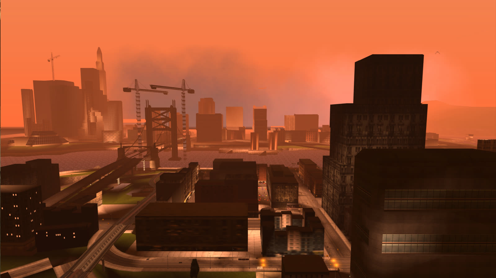

## GTA Stories: both cities in one world (experimental)

Liberty City Stories and Vice City Stories run together as one world. A bridge leaves Portland's east shore, runs out
over the sea and lands on the airport road of Vice City's Escobar International. You can cross by bridge, boat or
air, in a car, on foot or flying, and your car, money, health, armour and weapons come with you. Both cities'
vehicles can cross both ways.

| | |
|---|---|
| 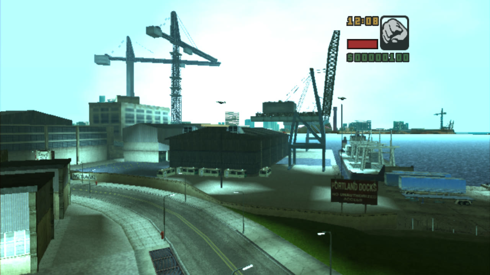 | 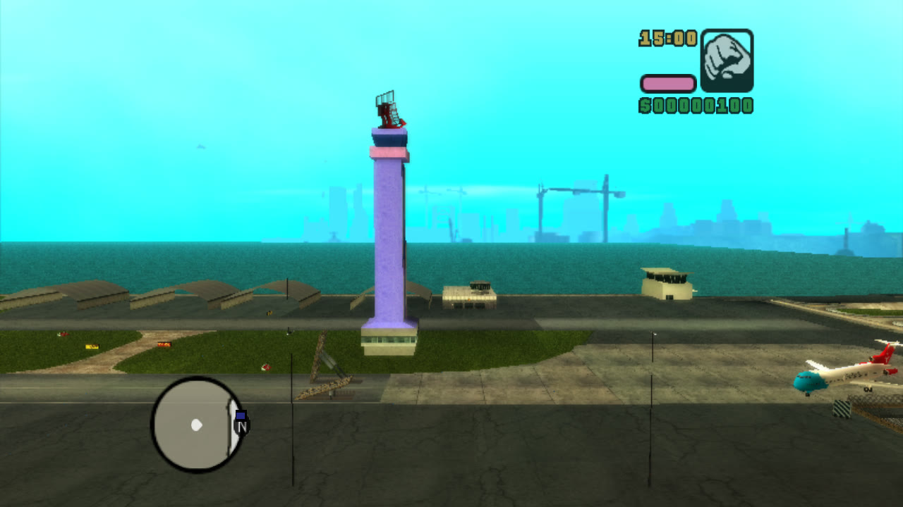 |
| Vice City on the horizon from Portland Docks | Liberty City on the horizon from Escobar International |
| 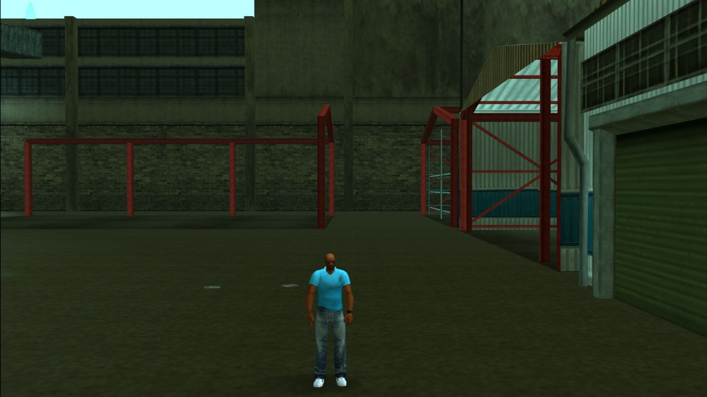 | 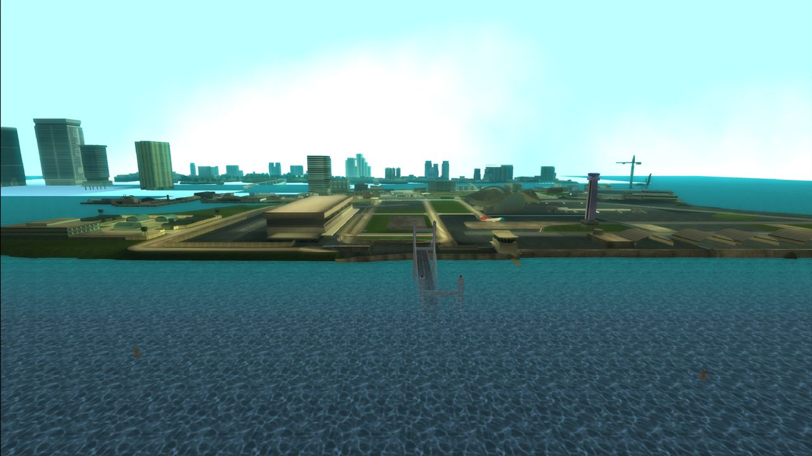 |
| Vic Vance at Portland Docks | Over the border, looking east to Vice City |

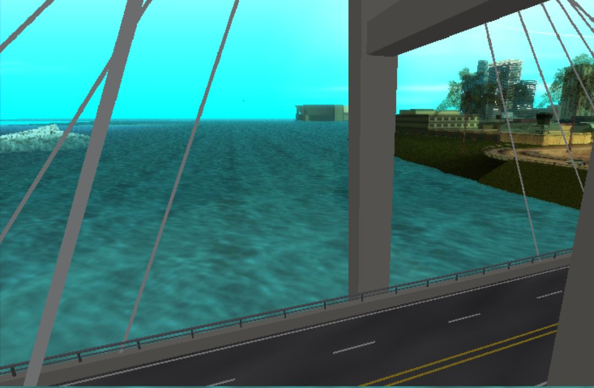

*The bridge's Vice City end, on the seawall road of Escobar International.*

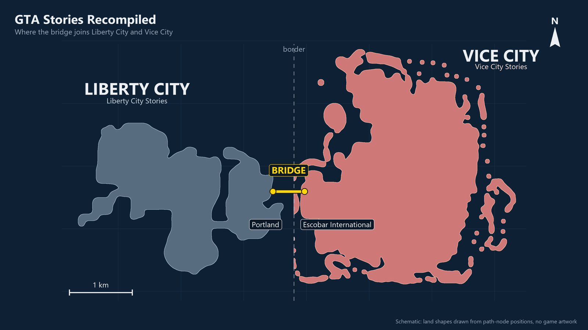

*Where the bridge joins the two cities.*

<!-- TODO(photo): add a wide, good-looking shot of the bridge at its current location (Portland grass ramp, y -407),
     taken with the final bridge. The earlier bridge photos are from the old location and were left out on purpose. -->

How it works for the player:

- **Start it:** open the launcher's **GTA Stories** tab (next to Liberty City Stories and Vice City Stories) and press
  **Play** once both games are built. From a terminal: `python tools/stories.py`.
- **Hero:** Vic Vance or Toni Cipriani in both cities, or each city's own hero (a three-way switch on the tab).
- **Saves:** your Vice City saves are synced back to your own Vice City memory card at the end of a session (with a
  backup of the card first; this can be switched off).
- **Fresh games** can start after each city's first story mission, from a *starter save*. **No starter saves are
  shipped**: you make them yourself (play each game's first mission, save, then
  `python tools/stories.py --set-starter lcs=<data folder>`, same for `vcs=`). Without them, a new Liberty City game
  starts as usual and the Vice City behind it skips its opening mission and starts in free roam.
- **Missions:** crossing the border during a mission fails it. Alternatively turn on "Border blocked in missions" and
  the border stays shut until the mission ends.
- **One program** (one window, both games inside `stories.exe`) is **experimental**, Windows only, and has to be built
  separately (`python tools/build.py --oneproc`).

It needs both discs, both games built, and Windows for now (Linux is untested). Limits and how it works:
[docs/STORIES.md](docs/STORIES.md).

## What's included

- **Liberty City Stories** (USA, SLUS-21423): this project's own recompilation. Free roam and all 76 mission entries
  start and run; nobody has played the whole story through yet.
- **Vice City Stories** (USA, SLUS-21590): gothamor's recompilation, built into the same launcher.
- **GTA Stories**: both cities in one world (above).
- **Enhancements:** draw distance up to 1000% (Liberty City; Vice City up to 300%), traffic and pedestrians up to 300%,
  higher resolution, MSAA, widescreen with the HUD at the edges, frame rates up to 240 fps with game timing fixed,
  PC keyboard, mouse and gamepad controls ([docs/CONTROLS.md](docs/CONTROLS.md)).
- **In-game menus:** F2 settings, F5 [trainer](docs/TRAINER.md), F6 free camera, F9 / F10 quick save / load.
- **Universal mod loader** with a mod manager in the launcher ([Mods](#mods)).
- **A launcher** (Windows, plus Linux and macOS builds): checks your disc, builds the game, starts it, backs up
  saves ([docs/LAUNCHER.md](docs/LAUNCHER.md)).
- **Android:** an app that plays Liberty City Stories and Vice City Stories ([Android](#android)).

| Draw distance 100% vs 1000% | Traffic 100% vs 300% |
|---|---|
| 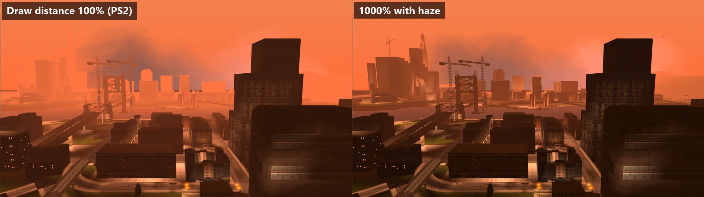 | 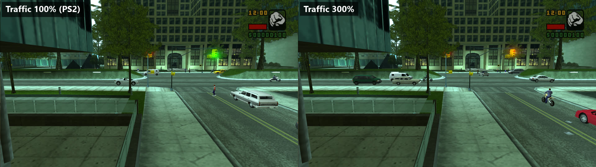 |
| **PS2 resolution vs 4x** | **4:3 vs 16:9** |
| 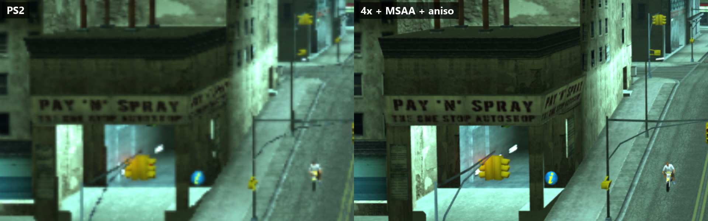 | 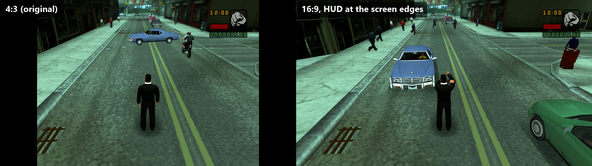 |

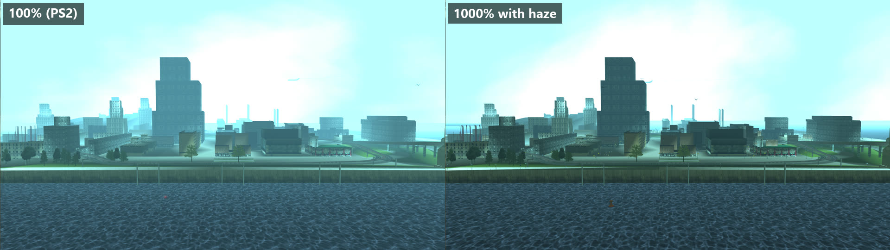

Clips: [flying over Portland](docs/media/clip_flyover_1000.mp4) · [a drive at 120 fps](docs/media/clip_drive_120fps.mp4) · [a mod car](docs/media/clip_mod_car.mp4)

## Install

**Bring your own disc.** Nothing from either game is in this repository or in the releases. You need a PS2 disc image
(`.iso`) of Liberty City Stories (SLUS-21423) and/or Vice City Stories (SLUS-21590), both USA. PSP versions cannot work.

1. Download your system's release from [**Releases**](https://github.com/batinium/gta-stories-recompiled/releases)
   and unzip it into a short folder, e.g. `C:\Games\GTAStories` (about 4 GB are needed there).
2. Start **GTAStoriesLauncher** and choose your `.iso`.
3. Press **Play**. The first time, the launcher **builds the game from your disc** (once; roughly 5 to 60 minutes
   depending on the PC; about 8 minutes per game on a fast PC).
   It needs internet once to download the compiler, and may sit on one step for a few minutes: that's normal.
4. For GTA Stories, give the launcher both discs and use the **GTA Stories** tab. Its extra packs (Vic's swimming,
   Vice City's vehicles, the hero) are **made automatically from your own discs** before Play.

Windows says *"Windows protected your PC"*? Choose *More info > Run anyway*. Mac: *Privacy & Security > Open Anyway*.

| The launcher | Game settings |
|---|---|
| 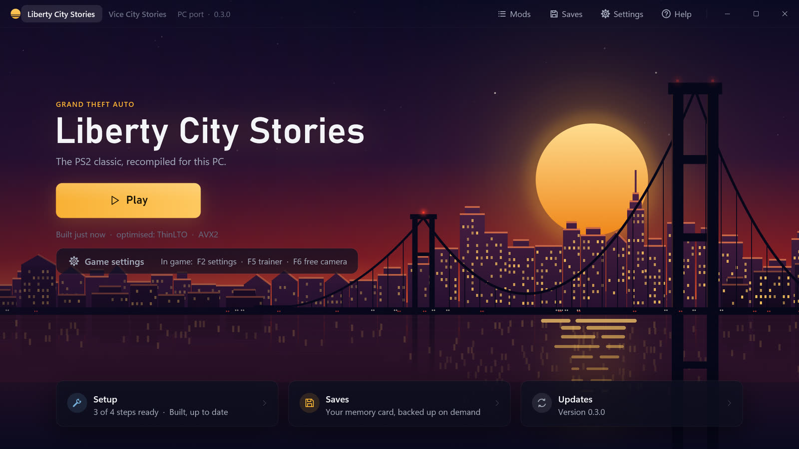 | 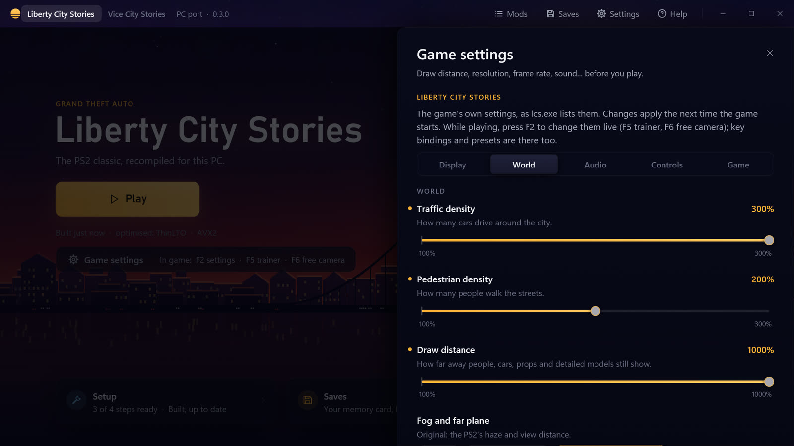 |

Full steps, Linux and building from source: [Player's guide](docs/PLAYERS_GUIDE.md).

### Android

Liberty City Stories and Vice City Stories on a phone, with touch controls (sideload only, not on Google Play).

<table>
<tr>
<td>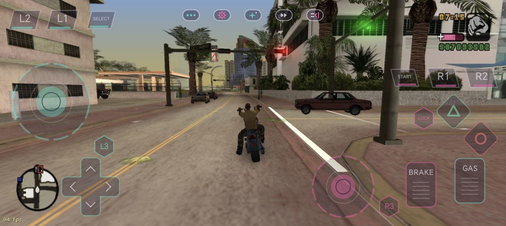<br><sub>Vice City Stories, on a bike (94 fps)</sub></td>
<td rowspan="2" valign="top">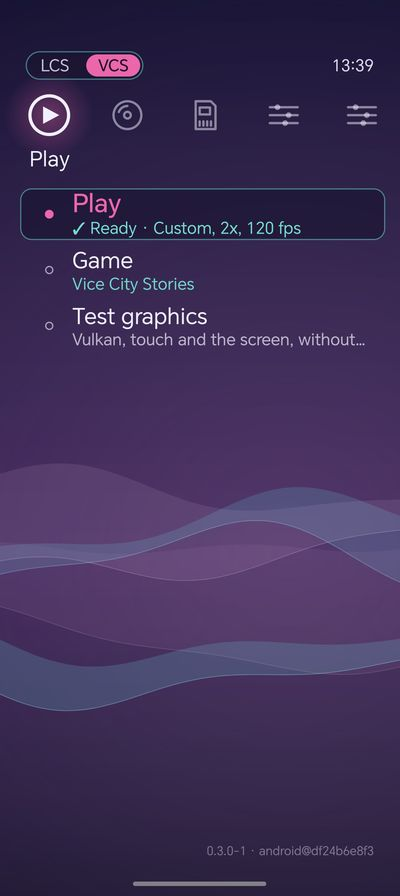<br><sub>The launcher</sub></td>
</tr>
<tr>
<td>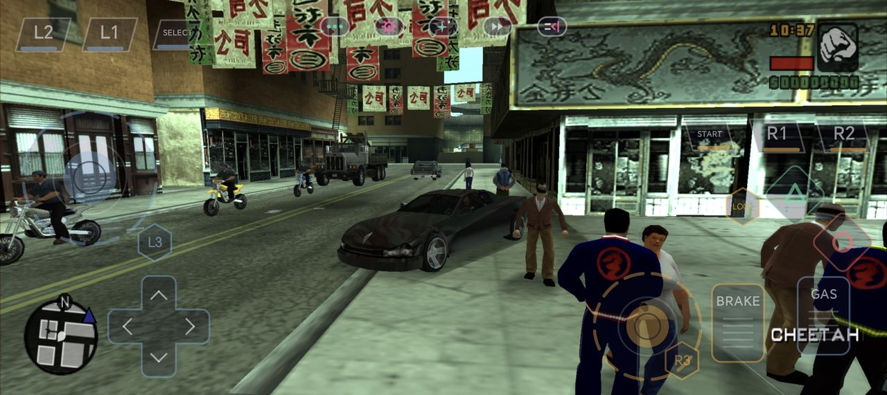<br><sub>Liberty City Stories, Chinatown</sub></td>
</tr>
</table>

- **Needs:** Android 13+, ARM64, Vulkan 1.3 (a recent Adreno GPU is recommended; others are untested), about 3 GB free per game.
- **The APK has no game inside.** One app holds both games (switch LCS / VCS at the top); each has its own disc, game
  library ("code pack") and saves.
- **Get a game:** pick your own disc image, then either
  - build the code pack **on the phone** (*Disc > Build code pack on this phone*, **experimental**): downloads Termux
    clang/lld once (~70 MB), takes 5 to 30+ minutes, needs ~1 GB free and 6 GB+ RAM, keep it charging. Tested only on an
    Android emulator so far, **not yet on a real phone**; or
  - build it on a PC (`python3 tools/recompile.py <iso>`, then `python3 tools/android.py build-game [--game lcs]`) and
    import it (*Disc > Import game library*).

  A code pack is made from your own disc: never share it.
- **Status:** both games reach gameplay on a test phone. Liberty City items **not yet checked on a phone**: sound, boot
  movies, the saves list, the side panel, some touch layouts, performance and mods. The both-cities mode on Android is a
  **prototype, not tested on a device**.
- **Mods:** the Mods screen takes `.zip`, `.vcm` or loose files (`handling.cfg`, `weapon.dat`, `.dff` + `.txd`, `.gxt`).
  **No `.rar` / `.7z` on Android** (unzip them on a PC first). Vehicle and weapon models (converted on the phone) and
  handling / weapon stats work; collision, animations, `.asi` / `.dll` scripts and a mod's own wheel do not. LCS mods on
  Android are unchecked.
- **Updating:** a release APK installs over a release APK (same signing key). If you installed a build you made yourself,
  export your saves, uninstall it once, then install the release ([Player's guide](docs/PLAYERS_GUIDE.md#1-install-the-app)).
- Frame generation (`Lossless.dll`) is not shipped: bring your own.

Steps and status: [Player's guide](docs/PLAYERS_GUIDE.md#android), [docs/ANDROID.md](docs/ANDROID.md),
[docs/PHONE_BUILD.md](docs/PHONE_BUILD.md).

## Mods

PC mods made for **GTA III, Vice City and San Andreas** can be loaded without PS2 tools or ISO patching, in Liberty
City Stories and Vice City Stories. Open the launcher's **Mods** screen, drop in a `.zip`, `.rar`, `.7z` or folder (on PC; Android takes `.zip`, `.vcm` or loose files),
pick the slot it replaces, and switch it on or off. Saves are not touched.

- **Vehicles:** cars and bikes (models, textures, handling, colours); heavy models are reduced in detail.
- **Weapons:** models and weapon stats.
- **Other:** handling and weapon-stat lines, sound replacements, text and whole-file replacements.
- **Not supported:** PC plugins (`.asi` / `.dll` scripts), collision, animations, and `.rar` / `.7z` on Android (PC only).
  Some mods do not convert well (a taxi mod drew only part of itself).

| Vice City car mod in LCS | Bike mod |
|---|---|
| 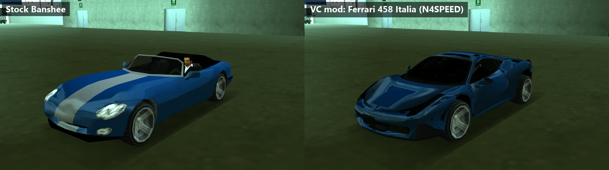 | 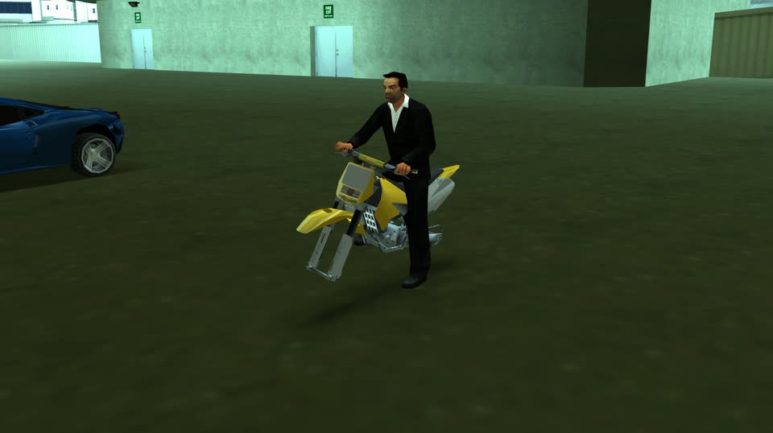 |
| **Vice City Stories too** | **The mod manager** |
| 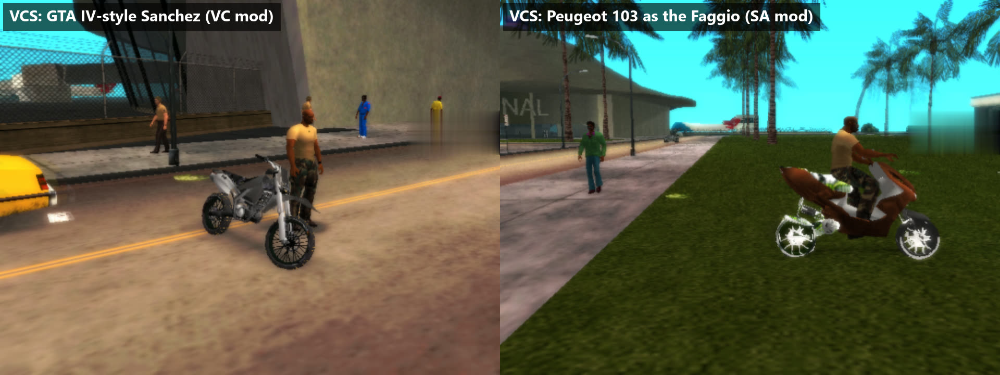 | 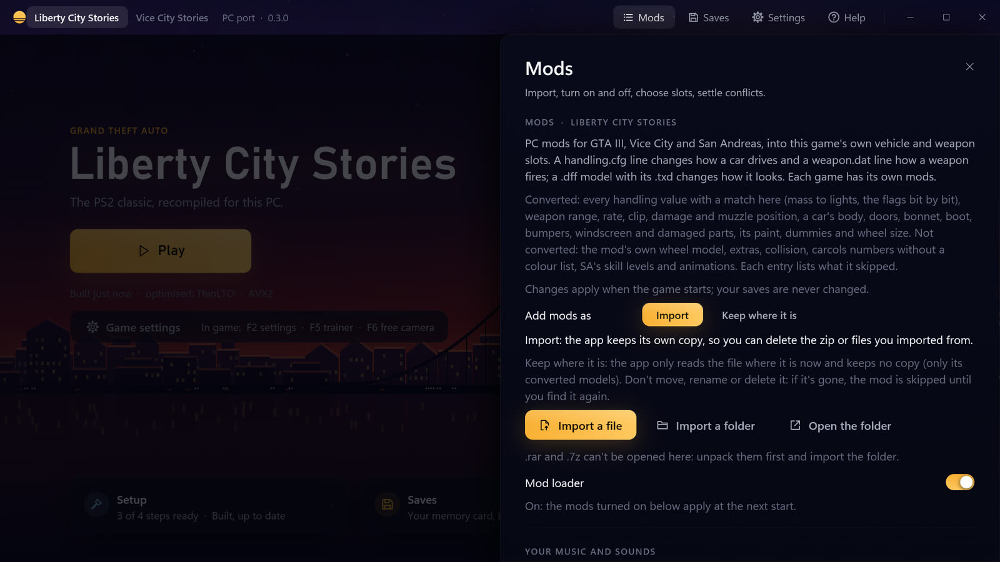 |

What converts and what doesn't: [docs/LCS.md](docs/LCS.md) "Mods".

## Status and known issues

Early, but playable. Honest list:

- **Liberty City Stories:** the whole story has not been played through by hand. Verified so far: the opening, the first
  mission, driving, bikes, boats, a helicopter, saves, long soak runs. Real mouse, pad and visible windows were less
  tested. Full list: [docs/LCS.md](docs/LCS.md) "Known issues".
- **GTA Stories is a prototype:** the bridge is simple (straight, flat, plain coloured shapes, no traffic or pedestrians
  of its own); cutscenes keep each city's own hero; the far city can look a frame or two old and its colours are its
  game's own; crossing waits during cutscenes and while a city loads; the pause menu's own options are not synced
  between cities; a crash in either game closes the one-program mode.
- **Vice City behind a new card** has no story unless you provide a starter save (see above).
- **Platforms:** Windows is the main target; macOS (Apple Silicon) and Linux builds exist but get less testing.
  GTA Stories is Windows only for now.
- **Android:** see above.
- Report Vice City Stories PC problems that are not about GTA Stories or mods to
  [gothamor/gta-vcs-recomp](https://github.com/gothamor/gta-vcs-recomp); everything else to
  [this project's issues](https://github.com/batinium/gta-stories-recompiled/issues).

### Next (0.3.1)

Planned, not done yet:

- **Android, one app with both cities:** "GTA Stories Recompiled" as a single app. Today the both-cities mode on Android
  only works as a personal build with both games inside. Planned: import a both-cities code pack, like the single-game
  packs.
- **Android, both cities:** crossing between the cities (switched off for now), the cross-game cars and the Vic/Toni
  outfit packs on the phone.
- **PC launcher:** a "Build for Android" button that builds the phone code packs. Today that takes the Android SDK/NDK
  and the command line.
- **GTA Stories:** the far city can freeze for a moment and then jump while the other game loads an area.
- **Mac:** GTA Stories (both cities) mode.

## Building from source

```
python tools/build.py --recompile <your VCS .iso>                  # Vice City Stories
python tools/build.py --game lcs --recompile <your LCS .iso>      # Liberty City Stories
python tools/stories.py                                           # GTA Stories
```

More: [CONTRIBUTING.md](CONTRIBUTING.md), [docs/LCS.md](docs/LCS.md), [docs/STORIES.md](docs/STORIES.md),
[docs/LAUNCHER.md](docs/LAUNCHER.md), [docs/ANDROID.md](docs/ANDROID.md), [docs/LINUX.md](docs/LINUX.md),
[docs/MACOS.md](docs/MACOS.md).

## Credits and legal

- **[gothamor/gta-vcs-recomp](https://github.com/gothamor/gta-vcs-recomp)**: the Vice City Stories static recompilation
  that this project is built on. Thank you!
  ([their README](docs/UPSTREAM_README.md))
- **[PS2Recomp](https://github.com/ran-j/PS2Recomp)** by ran-j (GPL-3.0): the PS2 recompiler and runtime, vendored in
  [third_party/PS2Recomp](third_party/PS2Recomp); our patches are listed in
  [docs/PS2RECOMP_PATCHES.md](docs/PS2RECOMP_PATCHES.md).
- **This project adds:** the Liberty City Stories recompilation, GTA Stories (both cities), the universal mod loader,
  the launcher changes and the Android port.
- The GTA modding community's file-format references ([gtamods.com](https://gtamods.com)).
- Mods shown: *Ferrari 458 Italia - Undercover Cop* by N4SPEED, *Maibatsu Sanchez*, *Peugeot 103*, *GTA 3 HD Weapons*,
  *M4V1DD* and *FN P90*, by their authors; used only to test the converter.
- Libraries: FFmpeg, SDL3, volk, Vulkan Memory Allocator, Dear ImGui, sse2neon, FreeType; frame generation from
  [Eden](https://git.eden-emu.dev/eden-emu/eden) / [lsfg-vk](https://github.com/PancakeTAS/lsfg-vk).

This is an **unofficial fan project**, not affiliated with or endorsed by Rockstar Games or Take-Two Interactive.
Grand Theft Auto and all game content belong to them. You bring your own legally obtained disc; nothing from the games
is distributed here. Licence: **GPL-3.0** ([LICENSE](LICENSE)).

## FAQ

**Is this a PC port of GTA: Liberty City Stories?**
Yes. It is a static recompilation of the PS2 game's code into a native PC program (Windows, with macOS and Linux builds
that get less testing). It is not an emulator. Vice City Stories is included too, and so is GTA Stories, which joins
both cities in one world.

**Do I need the game?**
Yes. Nothing from the games is in this repository or in the releases. You need your own PS2 disc image (`.iso`) of
Liberty City Stories (USA, SLUS-21423) and/or Vice City Stories (USA, SLUS-21590). The launcher builds the game from
your disc the first time you press Play.

**Is it the same as the PSP version?**
No. It is built from the PS2 versions (SLUS-21423 and SLUS-21590). The PSP versions are a different build for different
hardware and cannot be used.

**Does it run on Android?**
Yes, there is an Android app (sideload, Android 13+, ARM64, Vulkan 1.3) for both games with touch controls. The APK has
no game inside: you pick your own disc image and a game library built from it. Status and limits are in
[Android](#android).

**Can I use mods from GTA III, Vice City or San Andreas?**
Often yes. The mod loader takes cars, bikes, weapons, handling and weapon stats, sounds and text without patching the
disc; PC plugins (`.asi` / `.dll`), collision and animations are not supported. See [Mods](#mods).

**Where do I report problems or ask questions?**
Questions and ideas: [Discussions](https://github.com/batinium/gta-stories-recompiled/discussions). Bugs: the
[issue forms](https://github.com/batinium/gta-stories-recompiled/issues/new/choose). Contributing:
[CONTRIBUTING.md](CONTRIBUTING.md).
