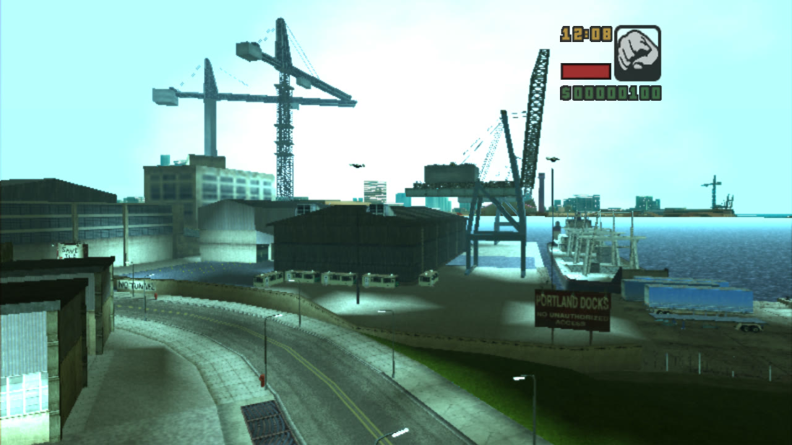
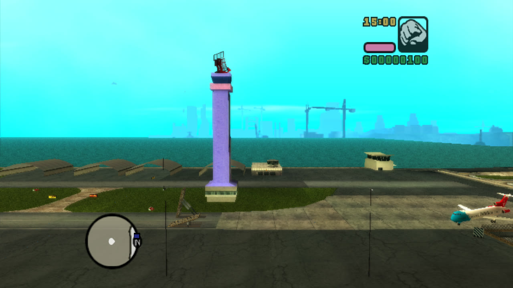

# Stories: both cities (experimental)

Liberty City Stories and Vice City Stories running at the same time, shown as one world: you play Liberty City as
usual, and Vice City stands on the horizon across the sea, east of Portland - its own city, its own traffic, its own
clock (kept in step with Liberty City's). It is an early prototype, off unless you start it, for players who want a
look and for contributors who want to help build the rest (below).



The other way round works too (Vice City in front, Liberty City's cranes and skyline across the water - a test run, not
yet started by the tool):



## What you need

- Both games built from your own discs: `python tools/build.py --recompile <your VCS .iso>` and
  `python tools/build.py --game lcs --recompile <your LCS .iso>`. Nothing of either game ships with this project.
- Windows desktop (the two games talk through shared memory; Linux has the code path but is untested; on Android a build-only prototype of the one-program mode: docs/ANDROID.md "Both cities on Android (prototype)").
- A machine that runs two games: Vice City in the background costs about one CPU core, ~0.7 GB of memory and a little
  GPU time (measured: both at 60 fps on a Core Ultra 9 275HX / RTX 5090 laptop).

## How to start it

In the desktop launcher: the **GTA Stories** tab at the top, next to Liberty City Stories and Vice City Stories. Its
Home says where each city stands (disc, build) and does what is missing right there: choose a missing disc (the usual
picker, checked), then **Build and play** builds whichever city is not built or out of date, one after the other, and
starts both; once both are built, it is just **Play** (docs/LAUNCHER.md "GTA Stories: both cities, the third tab"). The other-game packs (Vic's swimming, Vice City's
vehicles) are made by themselves before Play (below). Or from a terminal:

```
python tools/stories.py            # Liberty City in its window, Vice City hidden behind it
python tools/stories.py --check    # only checks that both games are built
```

Liberty City starts as always - your window, settings and saves. Vice City starts hidden and muted, without input, from a
memory card of its own (`<build>/stories/vcs-background`), in free roam: your newest Vice City save if you have one (a
copy: your own card is never written), else the starter save (after its first mission) when there is one, else a new
game without its opening mission (below, "Vice City behind: free roam" and "A new game starts after the first
mission"). A Liberty City card with no save starts from Liberty City's starter save the same way. It needs under a minute to get going; then Vice City appears on the horizon. Closing Liberty City
(or Ctrl+C in the tool's window) closes both. Logs: `<build>/stories/lcs.log` and `vcs-background.log`.

Without the tool nothing changes: the feature is switched on only by the `STORIES_DUALWORLD` variable the tool sets.

## The packs, automatically (`tools/stories_auto.py`, 2026-11-18)

The other game's things - Vic's swimming animations for Toni, Vice City's vehicles for Liberty City - are packs made
from the player's own disc (`tools/stories_pack.py`, below). Nobody has to run it: whenever the launcher knows both
discs it runs `tools/stories_auto.py` before Play (on any tab: plain Liberty City Stories gets the packs too), which
makes each pack that is missing or out of date and switches it on in the mod list.

    python tools/stories_auto.py [--for lcs|vcs|stories] [--lcs-iso X] [--vcs-iso Y] [--only swim,vehicles] [--force] [--check] [--json]

- **What**: `--for` is the game about to start: `lcs` (Liberty City alone: into its data folder), `vcs` (Vice City
  alone), `stories` (Liberty City's folder, and Vice City's background folder `<build>/stories/vcs-background`, the one
  `tools/stories.py` gives it). The discs: the options, else `iso=` in each game's vcs.ini.
- **Packs** (its `PACKS` table): `stories_vcs_swim` (swim, for LCS), `stories_vcs_vehicles` (vehicles, for LCS),
  `stories_lcs_vehicles` (Liberty City's vehicles for Vice City) - the last only once `stories_pack.py` says it supports
  that direction: a `DIRECTIONS` set containing `("lcs", "vcs")` or a `supports(src, dst)` function. Until then it is
  skipped ("not supported by tools/stories_pack.py yet"). `stories_pack.py` can add kinds of its own with a list
  `AUTO_PACKS` of the same dicts (kind, game, src, mod, args with `{iso}` / `{data}`, title, tools).
- **Current or not**: each pack folder gets a stamp, `stories_auto.json`: this tool's `PACK_VERSION`, the pack's own
  (`stories_pack.PACK_VERSION` if it defines one), a hash of the tools that make it (`stories_pack.py`, `vcs_disc.py`,
  `stories_swim.py` for the swim) and the disc (path, size, date). Any difference, a missing manifest or `--force`
  makes it again; the disc is not read when it is current (~0.7 s for the whole check).
- **On / off**: a pack made for the first time is switched on (`mods.py enable`); one the player turned off in the Mods
  sheet stays off when it is made again (the stamp remembers the tool made it). The mod loader's own switch
  (`loader_off`) is left alone.
- **Errors**: a pack that fails is named in the result (`failed`: title, message) and as an `@vcs` note; the others
  still go, the exit code stays 0 and the launcher plays without it, saying so. `VCS_STORIES_AUTO_FAIL=<kind or mod>`
  makes one fail (tests).
- Checked (2026-11-18, the user's two discs, a scratch data folder): from nothing, swim 0.7 s and the 111 vehicles
  27-35 s, both on in `mods.py list` and `active.txt`; again: both current in 0.66 s; a changed tool hash made the swim
  pack again and kept it off after the player had turned it off; `--for stories` lists `stories_lcs_vehicles` as not
  supported yet; a failing pack (bad arguments, and the test switch) reported, the rest made.

## Crossing over (the bridge, or by boat)

**The bridge.** A cable-stayed road bridge leaves Portland's east shore (a grassy beach below the cliffs at y -407; its
deck starts on the grass at x 1466, ground 12.5 m, and rises over the beach to 13 m) and runs straight east out over the sea,
14 m wide between two parapets (two lanes each way), past the border, to Vice City's
west shore: a long, gentle ramp lands it level on the seawall road of Escobar International (Vice City x -1833, y -407),
a T-junction (the seawall road runs north - south; brake: a yellow-edged wall of the airport yard stands 10 m past it). Drive it, walk it, cross it either
way; boats pass under it. It is the same bridge in both games at the same place (Vice City = Liberty City +
(-3800, 0, 0)), so the handover happens on it and you arrive still on it, in your car. Each game draws it itself, with
our own drawing (no game art): asphalt, a double yellow centre line, lane and edge lines, concrete parapets with a steel
rail, girders and piers down into the sea, two towers (one each side of the border) with their stay cables and red
warning lights, lamp posts that light up at night, the game's own fog over it in the distance.

**By boat**: take one in Portland Harbor and sail east, out past the end of the docks. At the border (Liberty City x 1800, a few hundred metres off Portland's east
shore) Liberty City hands you over: the picture fades to black (0.4 s), its window goes away and Vice City's comes up in its
place, fading in (0.4 s), with Vic in the nearest
matching boat (a Speeder stays a Speeder) at your speed and heading, west of Escobar International. Your money, health,
armour and weapons come with you, and the police lose you (the wanted level is cleared on both sides: crossing counts as
an escape). Liberty City is now the far city on Vice City's horizon. Sail back west over the same line and you are
Toni again, in Liberty City, where you crossed.

**Weapons** go to the nearest weapon of the other game in the same slot, with their ammo: pistol to pistol (.357 to
Equalizer), shotgun to shotgun, SMG to SMG (MP5 to SMG, Tec-9 to Scorpion, MAC-10 to Mac 10), M4 to assault rifle,
sniper to sniper, M60 to M249, melee to melee (screwdriver to butterfly knife, hammer to axe, cleaver to gaff hook) and
back. A weapon with no counterpart stays behind (Vice City's binoculars). The weapon in your hand stays in your hand: in a boat
it is the one you held before getting in (the game had put its drive-by weapon in your hand), and it is in your hand
again when you get out on the other side.

**Missions**: by default (`STORIES_DW_MISSION_BORDER=fail`) crossing the border during a mission fails it (below). The
option `STORIES_DW_MISSION_BORDER=block` (`tools/stories.py --mission-border block`, and the "Border blocked in missions"
switch on the launcher's GTA Stories tab) keeps you in the city instead: while a mission runs in the city you are in, the
border is a wall: on foot, in a car, boat, helicopter or plane you are put back just inside the line and the part of your motion going out is
bounced softly (a third of it, 3 m/s at most), and the notice "Finish the mission before crossing the border" shows. When the
mission is over the border works again. With `fail` (the default) crossing is never blocked, but the mission fails, the normal way: "MISSION FAILED", the
mission's own cleanup, and you can start it again from its marker, as after any fail. It is the game's death / arrest
path (the mission script is told the player is out, so it takes its own fail branch), without the death: no hospital,
nothing taken. `dualworld fakemission 1|0` (tests) holds the mission-running byte. Vice City behind never plays its opening mission ("Soldier"), so a crossing has nothing of it to fail
(below).

**The real car, from your own disc (experimental).** Vice City's vehicles can come over as themselves instead of their
nearest Liberty City model: `python tools/stories_pack.py build <your VCS .iso> --game lcs` reads all 111 of Vice
City's vehicles ONCE from your disc and puts them into Liberty City's mods folder as a mod (`stories_vcs_vehicles`; see
"Cross-game vehicles" below) - the launcher does this by itself before Play once it knows both discs ("The packs,
automatically" above). Then a Vice City vehicle crosses as itself, both ways: Vic's Sabre Turbo arrives in
Liberty City as the Sabre Turbo, with its own model, textures, wheels and handling, and goes back as the Sabre Turbo.
They are also in the trainer (F5 > Vehicles > Spawn vehicle): two pages, "Liberty City Stories vehicles" and "Vice City
Stories vehicles (from your disc)", each by Cars / Bikes / Boats / Aircraft, every row marked with its game's colour
(crimson / pink) and the Vice City names tagged "(VCS)". Without the pack nothing changes.

**Flying a helicopter or plane** (Vice City's come over flying, on a Liberty City helicopter / plane's handling): the
driving keys, as in the game's own helicopters: W (Cross) is the throttle / up, S (Square) down, A / D (the left stick)
steer and bank, Keypad 8 / Keypad 5 (the left stick up / down) tilt the nose down / up to fly forward / back, the L2 / R2
keys (1 / 3, Z / X) turn on the spot; F (Triangle) gets out. The keyboard's Driving page sets them (docs/CONTROLS.md).

The car or boat is matched by name from `tools/modslots/mod_slots.txt` (then its aliases, its "similar" list of the
same class, then the first of the same class: bike to bike, boat to boat). Driving a car into the sea or flying works the
same way in principle (any vehicle is handed over), but Toni drowns and helicopters are rare - the bridge and the boat are
the routes.

## Choosing where the bridge lands

`STORIES_BRIDGE_Y=<y>` (LCS coordinates, north is +y; default -407) moves the whole bridge (the two landings are made
for that line: Portland's grass slope at x 1466 and Escobar's seawall road at 13.95 m). `STORIES_BRIDGE_VCS_DY=<m>` (default 0)
moves only Vice City's end that far north (+) or south (-): the road then bends over LCS x 1630-1955 (the slope eases
in and out; the deck is drawn sheared along it and collided as yawed boxes ~20 m long), and `STORIES_BRIDGE_VCS_Z=<z>`
(default 13.95) is the height it lands at (the ramp is 0.7 degrees long). The old line (y -656, docks lane, landing
y -656 at the airport fence) ran into barricades and a fence at the Vice City end and ended in the sea off Portland's docks
(the first design: pier ramp x 1560-1625). To pick a spot, stand where you want an end
to be and use the trainer's Teleport > "Note position for the bridge" (either game): it appends
`<time> <LCS|VCS> x y z (LCS x y z)` to `stories/bridge_points.txt` in that game's data folder (the folder of its memory
card, e.g. `%LOCALAPPDATA%\GTAStoriesRecomp\LCS` or `...\VCS`) and shows "Position noted". The LCS coordinates are
the game's own in Liberty City and x + 3800 in Vice City (the both-cities offset is -3800, 0, 0).

## Known limits (prototype)

- **The bridge** is still simple: straight and flat (no arch), drawn with plain coloured polygons (no textures), and
  no traffic or pedestrians of its own (the games' traffic does not use it: their path nodes are fixed tables on the
  disc). Its ends meet the cities at single points: Portland's beach (x 1466, y -407, the deck's west end buried in the
  slope) and Escobar's seawall road (x -1833, y -407), a T-junction with the airport yard's wall 10 m ahead. Its collision is in each game's
  memory (the deck and its parapets are boxes in a col model of our own); `STORIES_BRIDGE=0` leaves it out.
- **A crossing in a car arrives in the car**, even if you press the exit button as the screen fades (the car seen at the
  line is the one handed over).
- **Crossing**: the game you left keeps your player still where you crossed (back over the line, you continue from the other side),
  and alive: his health and his vehicle's are held while that game is behind (`dualworld.cpp` holdAlive - a car left in
  the sea drowned Toni in 5 s and he was at the hospital on the way back). Crossing waits
  (a note on screen) while the other city is still loading. The window swap is fresh: report it if the new window does not come
  to the front (Windows may flash it in the taskbar instead).
- Past the border the far city replaces this city's far sea, so it stands on its own shore and sea, not on a band of
  this city's hazy sea. The two seas meet over 150 m of water past the line (`STORIES_DW_SEAM`); their colours are each
  game's own, so the meeting can still show (at night Vice City's far sea is much darker than Liberty City's). Above
  the horizon the far city still shows only where this city's sky is clear (both skies write depth).
- The far city's picture is a frame or two older than Liberty City's (2-2.5 frames on average at 60 fps, measured),
  but it is reprojected into the camera of the frame shown, so it stays locked to the world when the camera turns. What
  can still show: moving things over there are that much behind (cars), and a very fast turn can reach past the
  picture's 5% margin at the screen's edge for a moment (faded out there). `STORIES_DW_REPROJECT=0`: drawn as it is.
- The weather is matched (the city behind takes the front's, the nearest type: Vice City's hurricane is Liberty City's
  storm, its "extra colours" Liberty City's sunny), but each city keeps its own timecycle colours for it, so the far
  city's light is its own game's for that hour and weather. In Liberty City's fog Vice City fades out (the backdrop
  follows Liberty City's far plane), indoors it is hidden. From Vice City, Liberty City fades into Vice City's sky by
  its own fog (its far fog is handed over as transparency, "How it works"): in rain or fog it is out of sight across the
  water, as it is from Liberty City itself.
- The aspect ratio follows the city in front while playing (the setting, "Match window" and a resized window): the
  city behind takes its view widening at once, and its own aspect setting too (Settings in both-cities mode, below).
- Vice City behind on a new card without a starter save has no story: its opening mission is skipped, so its later
  missions never unlock. Play Vice City alone past Soldier, save, and both-cities mode takes that save (or make it the
  starter: below, "A new game starts after the first mission").
- **Stories: hero**: cutscenes keep each city's own hero (they use their own cutscene models). Dialogue and the hero's
  voice stay the city's own. The hero's jaw does not move in Liberty City (LCS's skeleton has no jaw bone).
- The far city at 3x internal resolution or more costs the city in front 5 ms a frame or more (the picture's copy and
  upload, see "How it works"); at 4K it is handed over at 1440p.
- The pause menu's own options (brightness, subtitles, radar / HUD mode, trails, language, the in-game radio) live in
  each game's memory and on its memory card, not in vcs.ini: they are not synced (each city keeps what its card has).
- A crossing waits (a short note on screen) during a cutscene or a scripted scene, in the pause menu, during the
  crossing fade and for 4 s after a crossing, and while the other city is loading or not running: sail on, it happens
  once the reason is gone.

## Vice City behind: free roam (2026-11-19)

Vice City behind Liberty City always starts in free roam, in both modes (two programs and `--oneproc`):

- **Your Vice City save, if you have one.** `tools/stories.py` (`background_card`) looks at your Vice City card
  (`%LOCALAPPDATA%\GTAStoriesRecomp\VCS\mc0`, the folder Vice City alone uses; `STORIES_VCS_DATA=<folder>` for another).
  When it holds a save newer than the background card's newest, the whole card is copied onto the background card
  (`<build>/stories/vcs-background/mc0`; the one it replaces is kept as `mc0.old`) - your card is only read. Vice City's
  boot then loads the newest save, as it does when played alone. A save you make in Vice City during both-cities mode
  goes onto the background card and is the newest there, so it is kept until you save newer in Vice City alone.
- **Saves go back to your card (`STORIES_SAVE_SYNC`, default on).** When the session ends (either mode, and each time
  the background Vice City stops and is restarted), `tools/stories.py` (`sync_back_card`) copies the background card
  back onto yours when it holds a save newer than the session's start. The card is a folder of slot files, so it is
  copied whole. Safety: your card is first backed up next to it (`mc0.bak-<date>-<time>`, the last 3 kept) and the new
  card is swapped in by rename. Nothing is written - a message says so and both cards stay as they are - when your card
  changed since the session began (you played Vice City alone meanwhile) or a Vice City process is running (it may
  have your card open). `STORIES_SAVE_SYNC=0` (or the GTA Stories tab's "Save Vice City progress to my Vice City card"
  switch) turns it off; the background card's saves are then kept only there, as before.
- **Else a new game without its opening mission.** On a new card Vice City's main script launches "Soldier" (JER_A1,
  mission 7) at once, and launches it again each time it fails (MAIN.SCM 0x7A96 and 0x7B28; the mission's fail branch
  sets global 3). Behind Liberty City every crossing failed it, so it came back with its intro cutscene, the player
  stuck in it. `dualworld.cpp` (`STORIES_DW_OPENING=0`, set by the tool) answers that one command -
  LOAD_AND_LAUNCH_MISSION_INTERNAL (opcode 0x289, handler 0x3B2208) with index 7 from the main script - by stepping
  over it: no intro, no mission, Vic in free roam at Fort Baxter where the start puts him. The main script waits in its
  loop as it does during Soldier; a loaded save never takes that path. `dualworld` (control) reports
  `opening_skipped=N`. `STORIES_DW_OPENING=1` plays the opening as before (and `STORIES_DW_MISSIONFAIL=0` is no longer
  needed for test pairs).
- No save ships with the project (game data), and a pass of Soldier forced by the tool would need its whole cleanup;
  skipping the launch gives the same free roam with nothing of the mission left. A starter save made by the player
  (next section) comes before this: with one, Vice City behind starts after Soldier instead.

## A new game starts after the first mission (starter saves, 2026-11-19)

`STORIES_STARTER_SAVES=1` (the default; `0` = as before: Vice City's opening skipped, Liberty City's new game as
usual). A **starter save** is a memory card with one save made right after a city's first story mission - Liberty
City's Home Sweet Home, Vice City's Soldier - so the story goes on from the second mission (its contact marker on the
map). When both-cities mode starts a city that has no save to start from, `tools/stories.py` makes that city's card
from the starter, and the game's boot loads it as it loads any newest save:

- **Liberty City**: the card it plays (your own, `%LOCALAPPDATA%\GTAStoriesRecomp\LCS\mc0`; `VCS_DATA_DIR` for
  another) when it has **no save at all** (`lcs_starter`). An empty card's folder is kept as `mc0.old`. A card with any
  save is never touched, so a player who has played keeps his game. From then on it is your card as always: your saves
  go on it.
- **Vice City behind**: its background card, when neither it nor your Vice City card has a save (`background_card`: your
  newest save still comes first). The save sync back (`STORIES_SAVE_SYNC`) only takes saves newer than the starter.
- **Where the starters are**: `<build>/stories/starter/lcs` and `<build>/stories/starter/vcs`, each a data folder
  holding `mc0/`; else `STORIES_STARTER_DIR/starter_lcs` and `starter_vcs`. No save ships with the project: play the
  first mission in each game alone, save (at a safehouse, or the quick save), then
  `python tools/stories.py --set-starter lcs=<that data folder>` (or `vcs=`) copies its card into place (the game's
  data folder is the one holding `mc0`, e.g. `%LOCALAPPDATA%\GTAStoriesRecomp\VCS`). Without a starter nothing changes:
  Liberty City starts a new game, Vice City behind skips its opening (`STORIES_DW_OPENING=0`, above).
- **Vice City's starter must be a save point's save** (the barracks' save icon at Fort Baxter, right after "Mission
  Passed"): a quick save (`saveanywhere quick`, F9) of the same moment loads as a new game - the main script's
  "loaded" path needs what the save point sets (the save icon's script), as on Liberty City before `lcs_save.cpp`
  learnt it (LCS.md) - so Vice City started over at Soldier. Liberty City's quick save works (`lcs_save.cpp` sets it).
- **Only a save point's save is installed** (`background_card`, 2026-11-19 starterfix): the quick save slot (8) of a starter card is
  dropped from the background card's copy (the starter folder is untouched), whatever the card holds; a card with only that
  slot is no starter (a new game in free roam).
- **Vice City is not ready while a save loads** (`vcs::saveanywhere::loading`, dualworld's `ready`): the boot starts a new game, then
  loads the save; a crossing in that window is refused ("Vice City is still loading"). A crossing that ends in a crash or a death
  on arrival shows the hospital tutorial text in Vice City (the bridge's end, not the starter).
- The starter's slot files on the background card are dated 2000-01-01, so any Vice City save of the player's is newer
  and replaces it at the next start; the boot picks its save by the date inside the file, unchanged.
- Checked (2026-11-19, hidden runs, `tools/stories.py` with empty cards): Liberty City boots the starter (Toni at
  Atlantic Quays, $100), the "V" contact blip (VIC2, Slacker) at (1127.2, -1108.3) and walking into it starts the
  mission (its cutscene); F9 / F10 into slot 2 and back works; a second start with that card leaves it untouched. Vice
  City behind boots the starter in the barracks (58 scripts with `str_jer` / `storysc` running, $50, the opening not
  skipped since the main script takes the loaded path), the Martinez chevron on the radar; in Vice City alone from the
  same card, the pink marker at the door of Martinez's office (-1607, -135) starts the next mission (its cutscene; seen
  at 11:00 game time, not at 17:20: the marker may keep hours). Not checked: a save made in Vice City during
  both-cities mode from the starter going back to the player's card (the existing `STORIES_SAVE_SYNC` path).

## Settings in both-cities mode

One set of settings for both cities, so a crossing never changes the picture, the sound or the controls:

- **At the start** Liberty City's settings (its vcs.ini next to `lcs.exe`, the one its F2 menu writes) are the source.
  `tools/stories.py` makes Vice City a vcs.ini of its own for the run, `<build>/stories/vcs-background.ini`: your Vice
  City vcs.ini (its `iso=`, window place and Vice City-only settings) with every setting both games have taken from
  Liberty City's (`VCS_SETTINGS_INI`). Your own Vice City vcs.ini is only read, never changed.
- **While playing** each change you make in the city in front - the F2 menu, Alt+Enter, a preset - reaches the other
  city within a frame, through the shared memory (a record per change with a version counter: `dualworld.cpp`
  `syncSettings`), and is applied there the F2 menu's own way. Settings that apply at the next start (the GPU, and the
  resolution / timing where the renderer can't switch live) are saved and apply then, as in the menu. Changes made
  while Vice City is in front reach Liberty City and are saved in Liberty City's vcs.ini (Vice City's run file is never
  written), so they are there next time.
- **At a crossing** the arriving city already matches: aspect ratio and HUD layout, internal resolution, anti-aliasing,
  texture filtering, frame-rate cap, vsync and timing, window mode, size and place (the window comes up where the other
  one was), volumes, traffic and pedestrian density, draw distance, key, mouse and gamepad bindings, sensitivity and
  inversion.
- **Different ranges**: Liberty City's draw distance goes to 1000%, Vice City's to 300%: Vice City takes up to 300% (and
  Liberty City keeps its 1000%: only changes travel, never the clamped value back). The effects volume's default is
  each game's own (Liberty City 76%, Vice City 88%: the same loudness): at the default, each keeps its own.
- **One game only** (left alone in the other): Liberty City's colour filter resolution, far fog / haze, faster
  streaming, user tracks and swimming; Vice City's drive-by fire rate.
- The city behind draws its world at 300% draw distance at least (the far city across the sea), and its own value once
  in front. It never reads the gamepad, and is muted. (Until 2026-11-19 Liberty City behind kept its own value: LCS reads
  the setting itself each frame, so the floor went through Vice City's draw distance spec only; now
  `lcs::drawdist::setFloor`. Measured with `lcsdraw`: behind draw 300, far 3006 m, haze 1303 m; in front 100 / 1000 /
  1000 at noon.)

Inventory (2026-11-18, `--dump-settings-json` of both): Liberty City 138 settings, Vice City 133; 132 in both (the same
key, type, choices and meaning), of them `audio.sfx_volume` (default 76 / 88) and `enhance.draw_distance` (100-1000 /
100-300) with different defaults or ranges, `enhance.driveby_rate` locked in Liberty City.

## If a game stops

- Vice City stops behind (a crash): Liberty City goes on alone, with a note on screen; crossing is off until Vice City is
  back. `tools/stories.py` starts it again (up to `--restarts`, default 3), from its own card as at the start (about a
  minute).
- The city in front stops while the other is behind: the other one takes the front, its window comes up, and you are
  where you crossed over. "Stops" means its process is gone (each game publishes its process id and a host-frame
  stamp): a long frame (loading, a 4K target being made) is not a stop - a 5 s hitch once swapped the cities by itself
  in a test before this check. Closing the city in front yourself (its window) ends both, as before.

## The window, the focus and the mouse at a crossing

Each game has its own window; the one behind is hidden. Windows lets only the program in the foreground give the
foreground away, so the game leaving the front waits for the other game's window to be shown (both windows' handles
are in the shared memory), puts it in the foreground (`SetForegroundWindow`, `AttachThreadInput` if refused) and only
then hides its own. The arriving game captures the mouse again as soon as it has the focus. If another program has the
foreground (you switched away), nothing is taken from it. Log: `[dualworld] foreground: handed to the other game's
window (...): ok` in the game left's log (hidden test runs only log what they would do). Not yet tested with shown
windows (2026-11-18): report "REFUSED" or "another program has it" lines.

## Vehicles at a crossing

The vehicle keeps its whole motion: the move speed (along, sideways, up and down) and the turn speed are carried and set
on the arriving vehicle for its first four frames (the arrival makes it level at the speed along its heading first);
height is kept. A Vice City helicopter arrives with its rotor at full speed (CVehicle +0x700, top 0.22), so it does not
drop. Aircraft map to aircraft (the car map: a plane with no plane on the other side takes the nearest helicopter); a
packed Vice City helicopter crosses as itself (Liberty City binds it into a model with its helicopter handling, and it
flies), and back. A vehicle with no counterpart at all never leaves you on foot in mid-air: you arrive at sea level (or
on the deck). A helicopter arriving in Liberty City (its own or a packed Vice City one) gets its rotor at full speed too
(CAutomobile +0x670, top 0.22: docs/game-internals.md, LCS's vehicle pool and rotor). A vehicle on the water (a boat,
a seaplane) keeps its height above the sea rather than above zero: the seas differ (z ~1 in Liberty City, ~6.6 in Vice
City), and a boat used to arrive 5.8 m under Vice City's sea or drop 5 m into Liberty City's, losing most of its speed.
Since the seas are lined up (the offset's z, below) every arrival is already lifted / lowered by the sea's 6 m; the boat
rule (5.6 m between the boats' own floating heights) is the same to within 0.4 m and stays for `STORIES_DW_SEAMATCH=0`.

If the game's vehicle pool is (nearly) full when you arrive, the arrival waits up to about 2 s for the game to free a
slot, then you arrive on foot (both cities: making a vehicle in a full pool would crash the game).

## One program (experimental, Windows)

Both cities can also run as **one program with one window** (`stories.exe`): the game in front is the picture in that
window, the other one runs behind it in the same program. Crossing the border switches which game the window shows -
there is no second window to swap to, so the keyboard and mouse stay with the game and nothing flashes in the taskbar.

- Build it once (both games' DLLs and the host; the normal `lcs.exe` / `vcs.exe` are not touched):
  `python tools/build.py --oneproc` (into `build/oneproc/lcs` and `build/oneproc/vcs`; `--quick` for a fast test build).
- Play it: the launcher's GTA Stories tab shows **One program (experimental)** once it is built; switch it on and press
  Play. Or `python tools/stories.py --oneproc` (the same switches as the two-program mode; the log is
  `build/stories/oneproc.log`).
- Liberty City uses its usual settings (`build/lcs/vcs.ini`) and saves; Vice City its background card, as before.
- Limits: a crash in either game closes both (a message says which); the two games' log lines are in one file. The
  window's place and size are not remembered yet. Tested hidden only so far (both boot, the far city, crossing by boat
  both ways); keyboard focus at a crossing on a shown window still wants a player's check.
- The mouse (camera): SDL never sees a child window as focused (its Windows backend compares `GetForegroundWindow()`
  with the window, which for a child is never true), so without help the game never captured the mouse. When hosted,
  `platform_sdl3.cpp` (`syncHostedFocus`) gives SDL the keyboard focus itself while the game's child is the one shown
  and the frame is the foreground window, and takes it back otherwise; the relative mouse mode and raw input follow it.
  Only the game in front ever captures. The raw-input mouse registration is per process, and the other game's SDL
  removes it when it lets go: the front game re-registers when it sees it gone (`watchHostedRawMouse`). Log lines:
  `[input] hosted focus on/off: ...`, `[input] hosted capture on/off: ...`, `[stories] frame activated/deactivated`.

How: each game is built as a DLL (`VCS_GAME_DLL`, `src/stories/game_dll.cpp`) - a DLL has its own copy of everything
static, so the two runtimes, renderers (two D3D11 devices) and SDL copies stay as separate as two programs. The DLL's
`getenv` / `_putenv_s` go through a per-game environment (`-Wl,--wrap`), filled by the host from `--env lcs:NAME=value`
/ `vcs:NAME=value`. `stories.exe` (`src/stories/host.cpp`) owns the one top-level window; each game's window is a child
of it (`src/platform/stories_child_win32.cpp`, `platform::hosted()`), shown by the game in front and hidden by the one
behind (`dualworld.cpp` onHostFrame, unchanged otherwise: its shared block works inside one process too).

The far city's picture goes over on the GPU (`STORIES_DW_GPU=0`: the CPU path): the background game copies its frame
into one of two textures shared with the front game's renderer (D3D11, keyed mutex: `rhi::Device::createSharedTexture`)
at its own resolution, and the front game samples it in the same composite pass (`ps_dw_backdrop`). Measured: 0.3 ms
in the background game instead of a 2-5 ms read-back, no upload in front. Not done yet: the same-frame composite (the
picture still lags the camera by a frame or so), and one renderer drawing both games into one depth buffer (a design
only).

## How it works

- Two processes, unchanged engines: each game still believes it is alone, its world box (about +/-2000 m) untouched.
- `src/game/dualworld.cpp` (both games): `STORIES_DUALWORLD=front|back`. The front game publishes its camera (position,
  front, up, FOV) and clock in a named shared memory block each game frame. The background game, in the free camera's
  height-routine hook (`vcs_freecam.cpp`, `lcs_freecam.cpp`), puts its camera there plus the offset
  (`STORIES_DW_OFFSET`, default Vice City = Liberty City + (-3800, 0, 6)) and its clock to the front's.
- The seas line up (farsea, 2026-11-19). Liberty City's water is at z 0 (CWaterLevel's levels, lcs_swim.cpp; a boat floats at
  ~1.0), Vice City's at ~6 (a boat floats at ~6.6). With a vertical offset of 0 the background camera, at the front's
  height, sat 4-6 m under Vice City's sea: the far picture showed the underside of its water (a turquoise band above
  Liberty City's sea and a cyan tint over the whole far picture), and a boat's far horizon looked wrong. The offset now has
  z = 6 (`STORIES_DW_OFFSET=-3800,0,6` is the same; a z given in the variable is always used as given;
  `STORIES_DW_SEAMATCH=0` = the old z 0). Everything that uses the offset follows it: the background camera, a crossing's
  arrival position (a vehicle on foot / in the air keeps its height *above* the new city's seas), the bridge's deck
  (stories_bridge.cpp draws and collides it in Liberty City's heights; Vice City lifts it by the offset's z) and the
  sea-height shader plane (`seaZ` 0 / 6, already so). The Vice City end of the bridge has to land on the seawall (z 13.95 in
  Vice City's heights), so in Liberty City's heights the deck now descends 5 m from the 13 at x 1697 over 270 m (1 deg)
  to 8 m, instead of climbing 0.95 m. Its first ramp box starts 15 cm under the flat deck (`STORIES_BRIDGE_DROP`): level,
  the flat box's front edge stood bare above a ramp falling away and threw a car (30 m/s: +9 m/s up at the joint,
  45 m/s: +14.5; with the step nothing, up to 45 m/s). Measured driving it: smooth at 32 m/s across the border, arrives
  on the deck in Vice City at z 16 (= 10 + 6), smooth to the seawall; and back.
- Far picture robustness (farsea): a composite that gets no GPU picture because the other game holds it (one process,
  `lockShared` 4 ms missed, or the writer had it for four reads) draws the last good one again, reprojected, up to 30 frames
  old (`STORIES_DW_HOLD=N|0`; it used to draw no far city for that frame: a flicker); a left-out picture (fog, interior,
  hidden backdrop) is not held. A frame that drew no native draw (the background game looking at open sea) now takes its
  tag from the frame (`Frame::dwTag`), not from the last frame that did: its picture got no camera, so no reprojection.
  `dualworld lag` also prints `held`, `lock_fail`, `no_gpu`; `dualworld` prints `picmiss` / `picoff` (pictures handed over
  with no camera) and the offset; `STORIES_DW_FRAMELOG=<file>` writes a per-composite log (tests).
- The renderer seams (`runtime/gs/gs_dualworld.h`, `gs_hw.cpp`): once per frame, at the game's full-screen Z clear just
  before its HUD (the world is complete there; the clear would wipe the depth), the background game marks its sky (depth
  still clear) as alpha 0, scales the frame into a picture and reads it back; the front game uploads the newest picture
  and draws it into its frame with a depth test that passes only where its own depth is still clear, blended by that
  alpha. The HUD is drawn later (the native HUD layer), so neither game's HUD gets into the other.
- The depth-correct composite (`gs_util.hlsl` `ps_dw_backdrop`, `dualworld.cpp` `publishView`): the front game hands
  the renderer its camera (CCam source / front / up, the FOV widened as the aspect does: Hor+ across, Vert+ up and down)
  and the border plane (`gsdw::setView`); the renderer takes the frame's Z mapping from its native draws: a draw's GS
  window matrix has a z row = a * w row + b, so Z = a + b / view depth (measured: LCS a 10428, b 115612; VCS a ~10462,
  b ~115620; Z24). The backdrop's pixel shader follows each pixel's ray: a ray that reaches the sea on this side of the
  border gets nothing of the other city (it cannot be there; this also stops it covering Vice City's own sea, which writes
  no depth); one that reaches it past the border writes the depth of its border crossing, and the GreaterEqual depth test
  lets the other city cover whatever this game drew beyond that point (its far sea), blended in over the first 150 m.
  Rays above the horizon keep the depth-clear rule. No depth is read back: the background game's picture is unchanged.
  `STORIES_DW_DEPTH=0` (renderer) or `dualworld depth 0` (control): the depth-clear composite only.
- The frame lag (`dualworld.cpp`, `gs_hw.cpp`, `ps_dw_backdrop`): the render thread composes a frame one or two game
  frames behind the game thread, and the background game rendered the camera of an earlier frame still. Each game frame
  gets a tag (`gsdw::setFrameTag`) that its native draws carry to the render thread, so the composite knows which
  frame it composes and takes that frame's own view; the background game hands each picture over with the camera it
  rendered it with (the shared block's `picCam`, keyed by its own frame tag). The shader follows each pixel's ray in the
  frame's camera and looks it up in the picture where that camera saw it: rotation exact, the camera's move since then
  with the other city taken on a plane 1200 m past the border (its parallax is under a pixel at driving speed). The
  background renders 5% wider than the view (`STORIES_DW_OVERSCAN`) so a turn finds picture at the edges. Measured
  (hidden pair, the picture held, the camera turned 3 deg yaw and 4 deg pitch): the far city was (-37, -48) px off at
  720p, (0, 0) reprojected. `dualworld lag` (frames behind, offset the picture had), `dualworld reproject 0|1`,
  `dualworld sweep ...` (tests).
- The picture's size (2026-11-18, user report "Vice City looks too blurry"): the background game hands its picture over
  at the front game's frame size - the rect the backdrop is drawn into, its internal resolution (e.g. 1707x890 at 2x
  16:9) - and both copies are point-sampled when the sizes match, so the far city is as sharp as the near one (it was
  1280 wide and scaled up). Its own internal resolution, anti-aliasing and filtering are the front's (the settings sync).
  The hidden window follows the shown one's size (internal resolution "Match window"). Budget `STORIES_DW_MAX=WxH`
  (default 2560x1440, 3.7 MP): a larger frame is handed over scaled down to it.
- Costs (hidden pair, 2026-11-18, RTX 5090 laptop, 16:9; the sink = blit + read back + copy into the shared memory on
  the background game's render thread; the composite = copy, upload and draw on the front's render thread; medians):

  | Front frame (internal resolution) | Picture | Sink | Composite |
  |---|---|---|---|
  | 1x (853x445) | 853x445 | 1.9 ms | 0.6 ms |
  | 2x (1707x890, about 1080p) | 1707x890 | 4.8 ms | 2.3 ms |
  | 3x (2560x1335, about 1440p) | 2560x1335 | 10.6 ms | 5.0 ms |
  | Match window at 4K (3840x2145) | 3840x2145 (budget lifted) | 23 ms | 12.5 ms |

  4K costs the front game 12 ms a frame (bandwidth: 33 MB a picture), hence the 1440p budget; 3x at 16:9 just fits it.
- The upload (2026-11-19, `robust`): the front no longer copies the picture out of the shared memory first - it is read
  in place (its slot held as `reading` until a newer one is taken; the haze still copies) and written straight into a
  dynamic texture (D3D11 Map WRITE_DISCARD; it was UpdateSubresource, a staging copy more). Composite, same hidden pair
  (2560x1440 window), median before -> after: 16:9 2x (1707x890) 1.16 -> 0.76 ms, 3x (2560x1335) 1.78 -> 1.46 ms, Match
  window (2560x1430) 1.83 -> 1.46 ms; 4:3 1x / 2x / 3x 0.23 -> 0.09, 0.58 -> 0.38, 1.39 -> 0.65 ms. (This run's "before"
  was already well under the 5 ms of the table above, measured on an older build.)
- The mission fail (`dualworld.cpp`, both games): CRunningScript::Process (LCS 0x10A678, VCS 0x255FA8) calls
  DoDeatharrestCheck (LCS 0x2FF130, VCS 0x258C18) for mission scripts. With deatharrest on and OnAMission 1 it asks
  IsRestartingAfterDeath (LCS 0x107578, VCS 0x24A650) and, if the player is out, unwinds the mission to its first frame,
  sets OnAMission 0 and "deatharrest executed". The mission's next command is HAS_DEATHARREST_BEEN_EXECUTED -> its fail
  subroutine (PRINT_BIG M_FAIL, ...) -> its cleanup -> MISSION_HAS_FINISHED. The hook answers yes once, only to the call
  from DoDeatharrestCheck (return address LCS 0x2FF190, VCS 0x258C94), in the three frames after a crossing. The
  FAIL_CURRENT_MISSION flag (LCS 0x3D9C34, VCS 0x4CD3F0) is set to 2 as well, for a mission with deatharrest off (its
  cleanup only, no fail text). `STORIES_DW_MISSIONFAIL=0` turns the hook off; `dualworld failmission` triggers it (tests).
- The fade (`dualworld.cpp` `checkBorder` / `handOver` / `updateFade`): the line crossed starts a 0.4 s fade out in the game
  left (`STORIES_DW_FADE_MS`, 0: none); at black the handover is written and the front swapped; the game arriving is
  black from its first frame in front until it has the player in place, then 0.15 s more, then fades in. The game left
  stays black for 0.6 s (its window is still up for 0.25 s). Drawn by our renderer over the picture and its HUD
  (`gsdw::setFade`), not with the games' own camera or script fades: those belong to the mission scripts, which may be
  failing the mission at that moment (Vice City's opening mission fades and restarts itself). Never black for good:
  the arriving game fades in after 3 s whatever happens, a crossing called off at black fades back in.
- The weather (`dualworld.cpp` `syncWeather`): CWeather's Old / New / Forced types (s16; LCS 0x3D9CAA / 0x3D9CAC /
  0x3DA190, VCS 0x4CD29E / 0x4CD2A0 / 0x4CD608, from FORCE_WEATHER_NOW LCS 0x325728 and CWeather::Update LCS 0x324C50 /
  VCS 0x3E3720). The front publishes Old / New; the background game writes them mapped to its own types each frame and
  Forced = New, so its own weather list never takes over; the blend between them follows the minute, and the clocks are
  in step. Released (Forced -1) when that game comes to the front: it goes on from the matched weather.
  `STORIES_DW_WEATHER=0`: left alone. The types are the same numbers in both games for 0-5 (sunny, cloudy, rainy,
  foggy, extra sunny, storm / hurricane: checked in hidden pairs, each weather shows the same kind of sky, rain and fog in
  both); Vice City's 6 (extra colours) and 7 (ultra sunny) go to Liberty City's sunny and extra sunny.
- The far fog as transparency (2026-11-19, agent tone; `gsdw::setFogToAlpha`, gs_hw.cpp `dwFogSlices`, gs_util.hlsl
  `ps_dw_fog_slice` / `ps_dw_unfog`). The report: "Liberty City looks dark on Vice City's side depending on weather".
  Measured (hidden pairs, the same place in both games, sunny / cloudy / rainy / foggy / extra sunny / storm at 07, 12
  and 20): the picture Liberty City hands over has exactly its own screen's colours (its post effects, brightness and
  timecycle as when it is in front; the composite matches LCS's own screen within 1 level per channel over the far
  city), and the composite neither darkens nor tints it. What made it dark: across the water the whole city is past
  LCS's fog (its haze is complete at about 1.3 x the timecycle's far clip with the horizon's 300% draw distance: 650 m
  in rain), so LCS draws it entirely in its fog colour - which in LCS is its own horizon's colour, the city fading out,
  but on Vice City's sky it is a flat silhouette: dark grey-green in rain and storm, dark at dusk, pale cyan at noon.
  Now the background game hands its fog over as alpha: its native draws give the fog (0..255 = fz * w + fy, the same w
  as the depth's Z = a + b / w), 48 full-screen quads at the depths of the fog's steps write the fog factor into the
  picture's alpha (no depth read-back), and the copy takes the fog colour out of the colour. Composited, the far city
  fades into Vice City's sky as it faded into its own fog: in rain and fog it is gone at that distance, as it is from
  LCS itself; near the border at noon it stands as in LCS. On by default for Liberty City behind; `STORIES_DW_FOGALPHA=0`
  as drawn (before), `=2` Vice City behind too (its fog matches its own sky; not needed so far);
  `dualworld fogalpha 0|1` (control, the game behind) switches it live.
- The live aspect (`dualworld.cpp` `syncAspect`): the front publishes its view widening (`vcs::aspectWidening`, the
  display aspect / 4:3) each frame; the background game applies it (`vcs::setAspectWidening`, `gsHwSetAspectWidening`,
  the presenter's aspect) when it changes, and sizes its shared picture to the aspect (1280 wide, at most 1344 tall:
  1280x720 at 16:9, 1280x960 at 4:3, 1008x1344 at 3:4).
- Control command `dualworld` (both games): state, counters, costs; `dualworld front` swaps which game is in front
  (the first piece of the border handover), `pause` / `resume` the background picture.

- **The bridge** (`src/game/stories_bridge.cpp`, both games). Stories' world collision is the col models of the
  building entities linked into the 40 m (Liberty City) / 80 m (Vice City) sector lists: cars
  (`CAutomobile::ProcessEntityCollision` -> `CCollision::ProcessColModels`, the wheel lines included), peds and line
  tests all go through them. The deck is three more of them, made in guest memory (0x68000-0x6FFFF) once the game is in
  play: a copy of a real `CBuilding` each, with its own box-only col model (the road and two kerbs) in a free slot of the
  model info table, a matrix pitched for the ramps, linked into the sector lists it covers - the engine collides with it
  by its own code, no collision query is hooked. Box ends sit buried in the ground or the next box (an end edge level with
  the road throws a car). Drawn by a renderer seam (`runtime/gs/gs_bridge.h`): the bridge's quads (about 3,400)
  projected with the game's camera - screen right made as forward x up, since the camera matrix's own right vector is
  RenderWare's and points left with the game's follow camera - coloured by the hour, fogged with the frame's own fog
  colour (FOGCOL), drawn into the game's frame at the dual world's point (the world complete) with the game's own depth
  mapping (Z = a + b / view depth, measured from its native draws), so cars and people on it and the world around hide
  it correctly. Each game frame's projection is kept under that frame's tag (dwlag's `gsdw::setFrameTag`, which the
  world's native draws carry), and the renderer asks for the frame it draws: the camera of that frame, not the newest
  one (the game thread runs ~1.6-1.8 frames ahead).
  Control command `bridge`: state, the projection's lag, `bridge sync 0|1` (tests).

## Cross-game vehicles (`tools/stories_pack.py`, 2026-11-18)

The two games' vehicle models are the same relocatable PS2 chunks (MDL model, XTX texture list; the few dialect
differences are in docs/LCS.md "Where LCS differs from VCS"), so the other game's real cars can be loaded through the
mod loader like a PC car mod:

1. **Once, from your disc** (`stories_pack.py build <other game's iso> --game <this game>`, standard library only): the
   other game's GAME.DTZ (zlib) gives its model infos, streaming entries and handling records; each car's MDL / XTX
   is read from its GTA3PS2.IMG; the shared wheel (resident in GAME.DTZ: VCS model info +0x28, LCS +0x24 -> LOD atomics)
   and the shared vehicle textures (VCS `xv_vehiclegeneric_sl`, licence plates ...: resident texture lists in GAME.DTZ)
   are found too. The PS2 geometry (VIF batches: int16 positions, uint8 UVs, int8 normals, the converter's own layout)
   and textures (8-bit CSM1 / 4-bit palettes) are decoded into a PC `.dff` / `.txd`, paint materials marked with the
   PC paint colours, intact / damaged parts named `<part>_hi_ok` / `_hi_dam`, the wheel under `wheel_rf_dummy`. The
   handling record becomes a `handling` line in handling.cfg units. Written to `<data>/mods/stories_<src>_vehicles/`
   (manifest.json, files/, vehicles.json); tools/mods.py's active.txt includes it.
2. **On demand** (src/game/lcs_crossover.cpp): spawning one (the trainer's list: ids 100000 + VCS's model id,
   `trainer spawn 100187`) or arriving in one binds it to a **new LCS model id** (217-236: VC's last vehicle ids, empty
   in LCS - no model info, empty streaming entries). The new id gets a copy of its **donor's** model info (the nearest
   LCS vehicle of its class, vehicles.txt's donor column; the class's default when the pack's is of another class:
   KURUMA, PCJ600, REEFER, MAVERIC, DODO) in guest scratch 0x72000-0x76000, a free texture list slot of its own (CTxdStore's
   pool), a handling record of its own, its VCS paint (vehicles.txt's colour pairs: the nearest colours of LCS's
   palette) and the text key `VCS<id>`. The mod loader converts the vehicle on the donor's stock model (vcs_mods.cpp
   `bindVehicle` donor=; cached as `lcs-<donor>-vcs<id>.*`) and serves it for the new id's streaming entries. Hooks give
   its vehicles their own handling record (the vehicle constructors), the donor's engine sounds (the audio's per-model
   table ends at 216) and the VCS name on the HUD ("Deluxo"; CText::Get answers `VCS<id>`). Helicopters and planes take a
   helicopter / plane donor and fly. 20 VCS vehicles exist at once (cars, bikes, boats and aircraft alike). An id whose
   vehicles are all gone (blown up and the wreck cleared, or culled) for 3 s has its model unloaded and is free; when all
   20 hold vehicles, the next spawn deletes the oldest VCS model's vehicles (not the player's, far ones first) and takes
   its id - a spawn is not refused. `STORIES_NEWIDS=0`: the old pool instead (below).
   The pool (the fallback): a free **pool slot** of its class - an LCS model with a handling record of its own that the
   traffic doesn't use: cars ESPRIT 187, SHELBY 185, PONTIAC 186, HOTROD 189, SINDACO 190, FORELLI 191; bikes ANGEL2 208,
   SANCH2 209; boats REEFER 195, SPEEDER 194, converted onto the slot's stock structure and put back once unloaded.
3. **At the border**: tools/stories.py's car map (STORIES_DW_CARMAP) sends each packed VCS vehicle as 100000 + its id
   (+ 1000 x its nearest LCS model, used when no slot is free); LCS binds it on arrival; a bound slot goes back as its
   VCS vehicle (dualworld.cpp mapCar). `--slot NAME=ID` still binds a vehicle to a fixed slot at start instead.

Limits: 20 VCS vehicle models at once. LCS itself keeps at most 12 vehicle models loaded at once, traffic's included
(0x3D0CCC, read by FUN_001910D0, which evicts one no vehicle uses, else the load fails; its ring at CStreaming +0x1E280
has 20 entries): while VCS vehicles are about the limit is raised to the ring's 20. The engine sound is the donor's
(LCS's sound banks are its own; VCS's bank numbers mean other sounds).

Checked (hidden LCS runs, 2026-11-18, `agents\crossover`): VCS's Deluxo, Sabre Turbo and Comet in fixed slots (drawn
with their own textures and VCS's wheels, paint from the slot's colours, driven 15-16 m/s after 3 s, 55-60 fps); then
on demand from the trainer (run p1): Deluxo -> 187, PCJ-600 -> 208, Maverick -> 185 (on its skids' wheels), Comet ->
186, and the Deluxo's slot unbound once it was gone ("LCS model 187 unloaded"); the F5 list with both groups (191 rows);
a hidden both-cities pair: Toni in VCS's Sabre Turbo (bound into 187) over the line, Vic took over in VCS's own Sabre
Turbo (model 273). All 111 VCS vehicles pack in about a second.

**LCS -> VCS** (src/game/vcs_crossover.cpp, 2026-11-19): `stories_pack.py build <LCS iso> --game vcs` packs LCS's 85
vehicles into Vice City's mods (`stories_lcs_vehicles`; the handling from LCS's records, LCS's helicopters and Dodo as
aircraft though their model infos say car); the VCS trainer lists them on their own page ("(LCS)"), and the border
handover keeps an LCS car crossing into VCS (100000 + its id; back as itself). Each is bound to a new VCS model id
(281-297, empty in VCS) the same way, but VCS needs fewer hooks: its model info points at its handling record (the
copy points at its own) and holds its sounds, so only CText::Get answers the LCS name. VCS has no free texture-list slot
with a streaming entry (only 831 below the collision base, none free), so a new id SHARES its donor's: the converted list
is the donor's own textures plus the LCS vehicle's, served for the donor - the donor's own cars keep theirs; a donor
lends to one LCS vehicle at a time (17 at once, any VCS vehicle of the class can be the donor). Wheels: VCS's converter
keeps the donor's shared wheel model, sized to the LCS wheel.

## One hero in both cities (`tools/stories_pack.py hero`, 2026-11-19)

In GTA Stories (both cities) you play **one hero in both cities**: Vic (the default) or Toni, chosen on the GTA
Stories tab's Home (a three-way switch: "Vic" / "Toni" / "Each city's own"). Both games get the same hero, so he
stays himself when you cross the border; "Each city's own" (`city`) is Toni in Liberty City and Vic in Vice City, the
old switch at the border. Command line: `tools/stories.py --hero vic|toni|city` (or `STORIES_HERO`; `city` is each city's own hero,
the old switch at the border). `STORIES_HERO` works for a single game too (Vic in Liberty City alone); the launcher
passes it only in GTA Stories mode.

The other game's hero is made **once, from your own disc of that game**, like the vehicles:
`python tools/stories_pack.py hero <your VCS .iso> --game lcs` (Vic for Liberty City, mod `stories_vcs_hero`) and
`python tools/stories_pack.py hero <your LCS .iso> --game vcs` (Toni for Vice City, mod `stories_lcs_hero`). Each
takes about half a second. Both are in `stories_pack.AUTO_PACKS`, so the launcher makes them by itself. A pack is
remade when the disc, the tool or `PACK_VERSION` changes, and is left alone otherwise. Without the pack the game's own
hero plays (the log says why).

**His own outfits.** Every outfit of the hero is in the pack, and each of this game's outfit names wears the closest of
them. A wardrobe or a mission outfit in Liberty City puts Vic in one of his own clothes, not one model everywhere.
`STORIES_HERO_OUTFIT=plr6` (one of the hero's outfit names below) wears that one everywhere.

| Liberty City's outfit (Toni) | Vic wears (VCS) | | Vice City's outfit (Vic) | Toni wears (LCS) |
|---|---|---|---|---|
| player (mafia suit, the default model) | plr2 polo and jeans | | plr (army fatigues, the default) | plr leather jacket |
| plr (leather jacket) | plr2 polo and jeans | | plr2 polo and jeans | plr13 jeans and T-shirt |
| plr2 lawyer suit | plr10 shirt and tie | | plr3 shirt and chain | plr12 dragon jacket |
| plr3 traveller | plr13 relaxed shirt, light jeans | | plr4 vest and jeans | plr3 traveller |
| plr4 Chinese jacket | plr3 shirt and chain | | plr5 shirt and trousers | plr15 smart, short sleeves |
| plr5 robbery mask | plr8 hoodie | | plr6 pastel suit | plr2 lawyer suit |
| plr6 tuxedo | plr6 pastel suit | | plr7 tracksuit | plr14 tracksuit |
| plr7 Guardian Angels | plr9 vest over a shirt | | plr8 hoodie | plr5 robbery mask |
| plr8 Elvis | plr12 Lance's shirt | | plr9 vest over a shirt | plr7 Guardian Angels |
| plr9 Cluckin' Bell mascot | plr5 shirt and trousers | | plr10 shirt and tie | plr16 smart, long sleeves |
| plr10 boxers | plr4 vest and jeans | | plr11 smuggler | plr4 Chinese jacket |
| plr11 Avenging Angels | plr army fatigues | | plr12 Lance's shirt | plr8 Elvis |
| plr12 dragon jacket | plr3 shirt and chain | | plr13 relaxed shirt | plr3 traveller |
| plr13 jeans and T-shirt | plr2 polo and jeans | | plr14 wetsuit | plr10 boxers |
| plr14 tracksuit | plr7 tracksuit | | | |
| plr15 smart, short sleeves | plr11 smuggler | | | |
| plr16 smart, long sleeves | plr6 pastel suit | | | |

(Vic's plr14 wetsuit is in the pack but no Liberty City outfit wears it. LCS's player2..player12 are unused placeholders
and wear the default.)

**How it works** (both games' player chunks compared byte by byte; aap's storiesconv `rsl.h` was read as a format
reference, none of its code is used):
- A ped model is the same relocatable "ldm" chunk in both games: {+0x20 collision model, +0x24 element group}. The
  element, geometry, material, skin and the skinned VIF / DMA batches are laid out alike (positions V3-16 @1, UVs V2-8
  @0x55, normals V3-8 @0x2B, weights V4-32 @0x7F, MSCAL 6), so the geometry is copied as it is. The translator
  (`tools/stories_hero.py`) rebuilds what differs:
  - The node (frame): LCS keeps a bone id at +0x9C, the anim tree at +0xA0 and the name at +0xA4; VCS has no ids, the
    tree at +0xA4 and the name at +0xA8.
  - The anim tree: LCS's is 0x60 bytes, with its matrices in the chunk; VCS's is 0x38.
  - The collision model's counts and pointers sit 4 bytes apart.
  - The object header bytes.
  - VCS hangs the element on a node of its own ("male_base01").
  - Textures: VCS's raster is 16 bytes and its texture 0x60 (+0x50 = 1); LCS's are 8 and 0x54. With 0x50-byte
    textures, VCS drew only the list's first texture and the rest showed its texels.
  - LCS's textures are mipmapped and swizzled (PSMT8 order, 4-bit ones too); VCS's are one linear level. Toni's go to VCS
    as their first level, unswizzled. Vic's work in LCS unchanged.
- **The skeleton is rebuilt as the target game's own, node for node.** LCS's animation update (0x333568) walks the
  skeleton by position (the node infos' push / pop flags) and matches keyframes by position too. VCS's skeleton has a
  jaw (bone 6) after the head that LCS's lacks. Kept, it shifted every later bone by one and Vic was drawn upside down
  (his thighs got the arms' keyframes). Vic's jaw is left out: its vertices go to the head (the weights' bone indices are
  remapped) and the head's flags become a leaf's. VCS's toes have no id (255; LCS 54 / 55).
- LCS (`src/game/stories_hero.cpp`): the player's outfits are special models. RequestSpecialModel 0x18FF80 looks the
  outfit's name up in a directory in GAME.DTZ (`*(streamInfo + 0x1E328)`: {sector, sectors, name[24]} x 160) and loads
  its texture list by the same name (the TXD pool `*0x3D7CA0`). Once GAME.DTZ is loaded (the mod loader's tables hook),
  the outfit names' entries (player*, plr*) point at the hero's outfit for each, served from host memory past the disc's
  end. No game code is hooked.
- VCS: its outfits are ordinary models: Undress 0x214900 looks the outfit's name up as a model. These are models 0
  (plr) and 155..167 (plr2..plr14) with texture lists 5 and 153..165. Their streaming entries are repointed in the same
  way, at GAME.DTZ's relocation.
- Toni in VCS gets a jaw bone, placed at his head with no vertices. VCS's skeleton has one, and its animations, like
  LCS's, reach the bones by place.
- The skinned draw (LCS 0x2E87A0): bone matrix = inverse bind x the animation's world matrix. The geometry's scale and
  offset are folded in. This is the same in both games, so only the skeleton's layout mattered.

Checked (hidden runs, 2026-11-19, `agents\hero`):
- LCS: Vic stands, walks and runs in Atlantic Quays. He gets into a Kuruma, sits at the wheel and drives (57 m in 3 s).
  His polo outfit is the default; the army fatigues, the pastel suit and the hoodie were shown with
  `STORIES_HERO_OUTFIT`.
- VCS (new game, Fort Baxter): Toni stands and runs in his mafia suit (the default for Vic's army fatigues). The
  Guardian Angels and Elvis outfits were shown with `STORIES_HERO_OUTFIT`.
- Both cities (hidden pairs through `tools/stories.py --hero`): with `vic`, Vic in his polo in Portland took a Speeder
  over the border (swapped in 0.47 s) and sat at the wheel in Vice City as Vic, then crossed back as Vic. With `toni`,
  Toni crossed and arrived at the wheel of Vice City's Speeder as Toni in his mafia suit.
- Not checked: a real wardrobe change in a running game, every outfit, missions with outfit changes, the launcher's
  "Play as" control clicked (built only: no windows were shown in the tests).
- Not done: an outfit picker in the trainer. A live change needs the game's own Undress / Dress calls run from the
  host; `STORIES_HERO_OUTFIT` sets one outfit at the start instead.

## Help wanted

Pull requests welcome. In rough order:

1. **Border handover** (done for boats, `dualworld.cpp` `checkBorder` / `takeHandover`; weapons, armour, wanted level
   and the mission fail and the fade done too). History: proven first in a test script. Toni drove a Banshee over a line in Portland;
   ~0.36 s later Vic sat in Vice City's Banshee (matched by name from `tools/modslots/mod_slots.txt`; names / aliases /
   "similar" column / same class) at Escobar, at the car's speed and heading, money carried, and `dualworld front` had
   swapped the roles (Liberty City became the far city). Missing: doing it in `dualworld.cpp` instead of a script,
   showing / hiding the two windows and moving the input, health / armour / weapons, the way back. VCS's trainer verb
   `arrive X Y Z HEADING MODEL SPEED` does the arrival.
2. **A land route** (done: the bridge, `src/game/stories_bridge.cpp`). Open: textures, an arch, traffic using it
   (new path nodes: the path graph is a fixed table loaded from the disc, so it needs node / link slots of our own),
   road links at each end beyond the single lane and the T-junction.
3. **Depth-correct composite** (done: past the border the far city replaces the near city's far sea; no floating band).
   Open: the two seas' colours matched where they meet.
4. **Lighting / fog matching** (the weather types are synced; each game still lights its city with its own timecycle).
5. **Vice City in front with Liberty City on its horizon** (the code paths exist: `dualworld front` on VCS).
6. A launcher entry (done: the GTA Stories tab, with the packs made by themselves), and Linux testing.
7. Later: one process for both games (started: "One program" above), carrying the
   real car across (the mod converter), missions that cross over.
